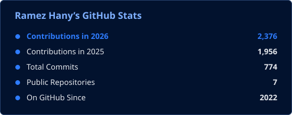
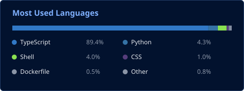

  

  

  
  

  <b>2,300+ contributions in 2026</b> · Platforms live for clients in <b>Egypt &amp; Saudi Arabia</b> · OTP service built with <b>Vodafone Egypt</b> · Incubated at <b>Creativa — ITIDA / TIEC</b>

---

## The Short Version

I'm a full-stack developer at **[Syncode](https://syn-code.com)**. I don't build demos — I build the systems businesses actually run on: a legal ecosystem platform, a governance consultancy's enrollment business, an exporter's sales pipeline, and a carrier-grade OTP service.

My standard is simple: **if it isn't verified live, it isn't done.** Every platform I deliver gets a full security pass — authentication, secrets, access control — before handover, not after the first incident.

- 🚀 **Flagship:** Syncode OTP — secure one-time-password service, built with **Vodafone Egypt**
- 🌱 **Building now:** [Feenak](https://syn-code.com) — NFC cards that open a full digital profile with one tap
- 🤝 **Open source:** on a public contribution ladder — currently inside **Dokploy**
- 📚 **Not a straight path:** three years into **Mathematics at the Faculty of Education**, I walked away — I loved math, but I wasn't growing anymore. I switched to **Psychology at the Faculty of Arts**, Alexandria University, to understand people and how they think — and I teach: my content connects Holland Codes (RIASEC) with the Enneagram
- 💬 **9,000+ followers** on LinkedIn read my breakdowns of building software properly

## Operating Principles

| | |
|---|---|
| **Ship to production** | Demos don't count — real users, real systems, real stakes. |
| **Verify live, or it didn't happen** | Every claim gets tested on the live system before it's called done. |
| **Security before handover** | Authentication, secrets, access control — audited, never assumed. |
| **One standard** | If I wouldn't sign my name under it, it doesn't ship. |

## Selected Work — Live in Production

| Platform | What it is | Stack |
|---|---|---|
| [LAWSUIT](https://www.lawsuit-platform.com) | Legal ecosystem platform — legal services, training & law-firm development (Egypt + Saudi) | Next.js · Payload CMS |
| [IGCC](https://www.igcc-eg.com) | International Center for Governance and Consultancy — courses, enrollment & payments | Next.js · Paymob |
| [BerryNova](https://berrynova-eg.com) | B2B exporter of IQF frozen produce — catalog, quote system & CMS | Next.js · Payload CMS |
| **Syncode OTP** | Secure OTP service for businesses — built with Vodafone Egypt | Production service |

> **Currently:** Building **Feenak** (NFC-card SaaS) · Climbing the **Dokploy** open-source ladder · Booking platform builds for trainers, coaches & service businesses.

## Arsenal

<table>
<tr>
<td align="center"><b>Frontend &amp; 3D</b></td>
<td align="center"><b>Backend</b></td>
</tr>
<tr>
<td align="center"></td>
<td align="center"></td>
</tr>
<tr>
<td align="center"><b>Systems Programming</b></td>
<td align="center"><b>Data</b></td>
</tr>
<tr>
<td align="center"></td>
<td align="center"></td>
</tr>
<tr>
<td align="center"><b>Cloud &amp; DevOps</b></td>
<td align="center"><b>Servers &amp; Networking</b></td>
</tr>
<tr>
<td align="center"> </td>
<td align="center">  </td>
</tr>
<tr>
<td align="center"><b>Editors &amp; Design</b></td>
<td align="center"><b>Libraries &amp; APIs</b></td>
</tr>
<tr>
<td align="center"></td>
<td align="center">        </td>
</tr>
<tr>
<td align="center"><b>Mobile &amp; Cross-Platform</b></td>
<td align="center"><b>AI Tools &amp; Assistants</b></td>
</tr>
<tr>
<td align="center">  </td>
<td align="center">       </td>
</tr>
</table>

## Proof of Work

  
  

  

## Open-Source Program

I'm building a public open-source presence before launching my own accounting software — one project at a time, each stage finished and accepted before the next begins.

| # | Project | Focus | Status |
|---|---|---|---|
| 1 | **Dokploy** | Contribution ladder: template → small fix → big fix → new feature | 🔨 In progress |
| 2 | **Payload CMS** | A plugin born from real production pain | 🗓️ Planned |
| 3 | **Twenty CRM** | Contributions to the open-source CRM (TypeScript) | 🗓️ Planned |
| 4 | **RustDesk** | Contributions, starting with Arabic localization | 🗓️ Planned |
| 5 | **KeePassXC** | Password-manager contributions (C++ / Qt) | 🗓️ Planned |
| 6 | **OTP Authenticator** | Contributions to an open-source TOTP authenticator | 🗓️ Planned |
| 7 | **Obsidian** | A community plugin | 🗓️ Planned |
| 8 | **Markdown Editor** | Editor project / contributions | 🗓️ Planned |
| 9 | **Markdown Viewer** | A companion viewer | 🗓️ Planned |
| 10 | **Mini MD Model** | A small model trained on Markdown that assists with design | 🗓️ Planned |
| 11 | **Tabs Manager** | A browser extension (Chrome / Firefox, TypeScript) | 🗓️ Planned |
| 12 | **OBS Studio** | A native plugin (C++) | 🗓️ Planned |
| 13 | **DaVinci Resolve** | A plugin (OpenFX / C++) | 🗓️ Planned |

## What We Build at Syncode

| Product | What it does | Status |
|---|---|---|
| **Syncode OTP** | Secure one-time-password service for businesses | ✅ Live — built with Vodafone Egypt |
| **Feenak** | NFC cards linked to smart digital profiles | 🔨 In development |
| **WhatsApp CRM** | Customer conversations, organised and automated | 🔨 In development |
| **Syn Dashboard** | One dashboard for your whole operation | 🔨 In development |
| **Dynamic QR & Analytics** | QR codes you can edit and measure | 🧪 MVP |
| **Digital Menu** | Digital menus for restaurants & cafés | 🧪 MVP |
| **Freelancer Accounting** | Accounting for freelancers — installments, BNPL & irregular income | 🧪 In design |

## Let's Connect

Building a product, a platform, or a personal brand that sells? Let's talk.

- 💼 LinkedIn: [/in/rramez-hany](https://www.linkedin.com/in/rramez-hany) · Company: [/company/syn-code](https://www.linkedin.com/company/syn-code)
- 🌐 Portfolio: [ramez-hany.com](https://ramez-hany.com)
- 🏢 Company: [syn-code.com](https://syn-code.com)

<em>BEYOND CODE. BUILT WITH INTELLIGENCE.</em>

  

